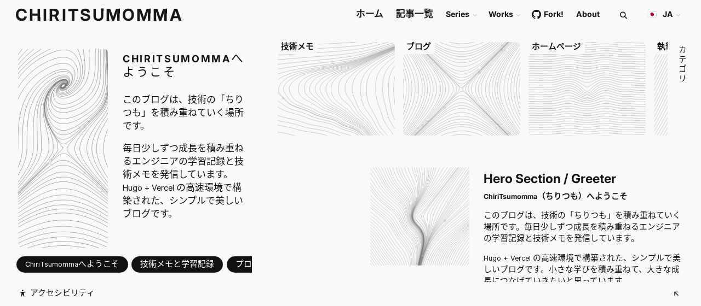

# ChiriTsumomma

技術の学びを少しずつ積み重ねる（ちりつも）個人ブログです。Hugo と hugo-brewm テーマで作り、日本語・英語・中国語の3言語で公開しています。

A personal tech blog by Sol-momma for study notes and small write-ups, built with Hugo and the hugo-brewm theme and published in Japanese, English and Chinese.

Live: https://chiri.sol-momma.com



## Features

- Posts in three languages (`ja`, `en`, `zh`) with a language switcher
- Post list, categories, tags, series and an about page
- Site search and an accessibility menu provided by the theme
- Static output only, so it can be served from any static host

## Tech stack

- [Hugo](https://gohugo.io/) extended, version pinned in `.hugo-version`
- [hugo-brewm](https://github.com/foxihd/hugo-brewm) theme, included as a git submodule
- [Cloudflare Workers](https://developers.cloudflare.com/workers/static-assets/) static assets for hosting (`wrangler.jsonc`)

## Getting started

There are no npm dependencies. You need Git and Hugo extended (the version in `.hugo-version`).

```sh
git clone --recurse-submodules https://github.com/Sol-momma/ChiriTsumomma.git
cd ChiriTsumomma
hugo server               # http://localhost:1313
```

To build the same way as production, run the build script. It downloads the pinned Hugo release into `/tmp` and writes the site to `public/`.

```sh
bash scripts/cf-build.sh
```

To add a post, create a Markdown file under `content/<lang>/posts/`:

```yaml
---
title: "Post title"
date: 2026-10-25T00:00:00+09:00
type: post
draft: false
---
```

## Project structure

```text
.
├── config/            # languages and menus
├── content/           # posts and pages, one folder per language (ja, en, zh)
├── i18n/              # translated UI strings
├── static/            # images and other static files
├── themes/hugo-brewm/ # theme (git submodule)
├── scripts/           # production build script
├── hugo.toml          # site configuration
└── wrangler.jsonc     # Cloudflare Workers settings
```

## License and credits

The posts and other content are the author's own work; no license is granted for reuse. The theme is [hugo-brewm](https://github.com/foxihd/hugo-brewm) by foxihd, under the MIT License.
